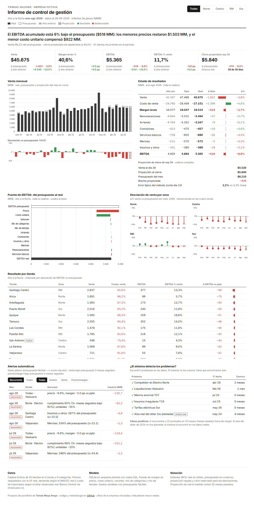
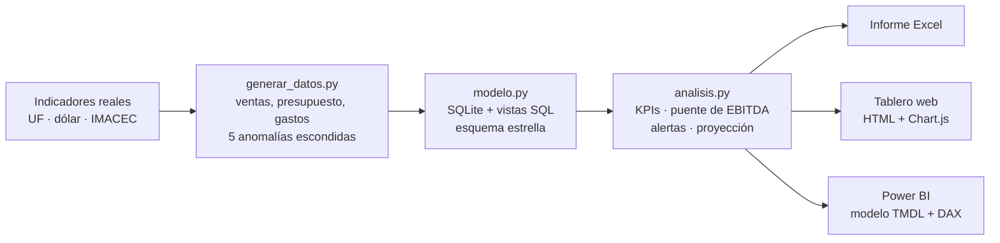
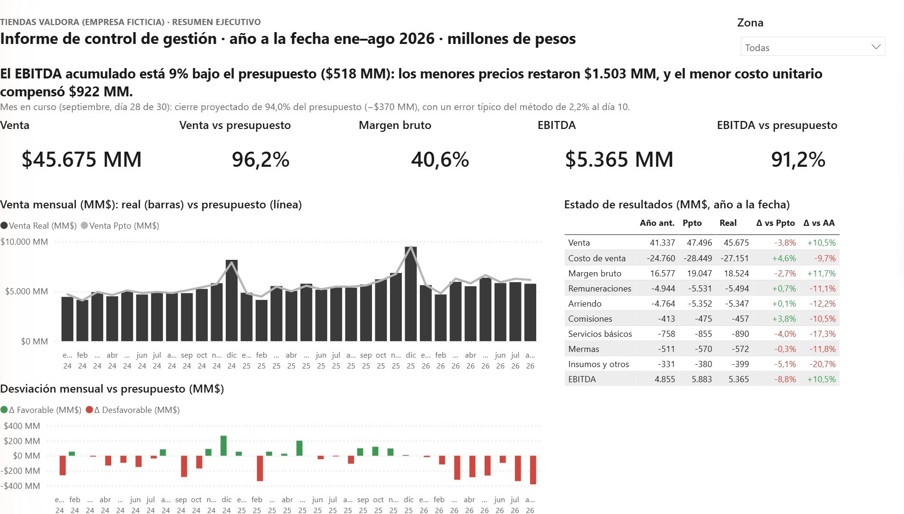
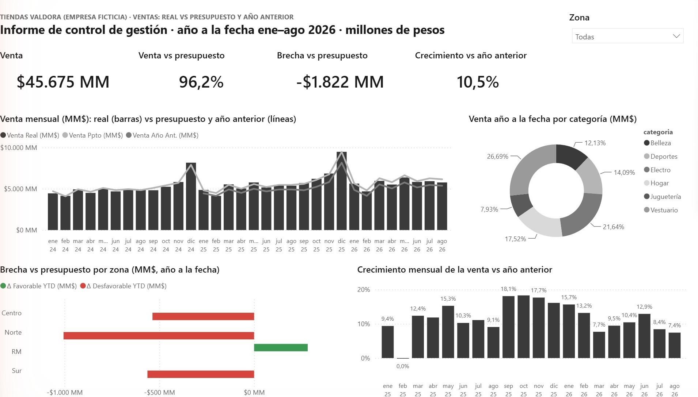
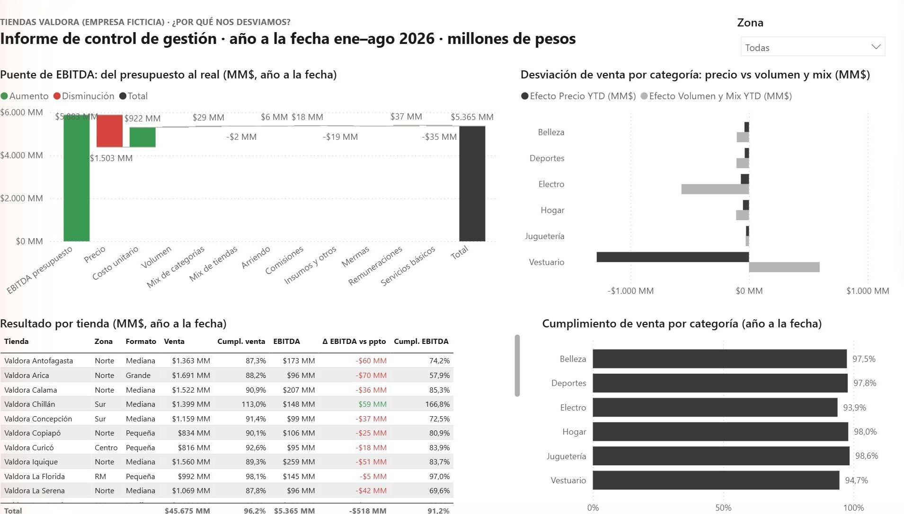
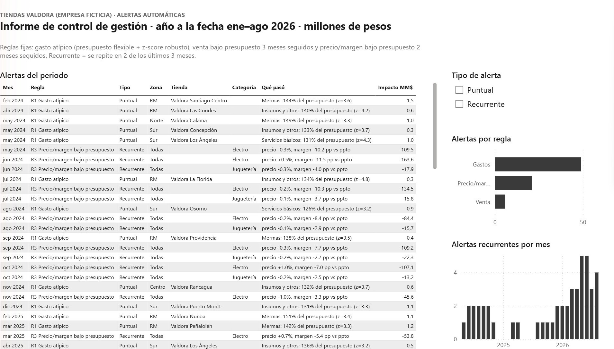

# Control presupuestario para una cadena de retail: de los datos a las alertas

Sistema de control de gestión para **Tiendas Valdora**, una cadena **ficticia** de 30 tiendas, 4 zonas y 6 categorías
(ene-2024 a sep-2026).

**[Ver el tablero web en vivo](https://tomasmoyaaraya.github.io/control-presupuestario-retail/)** · [Informe en Excel](resultados/informe_control_gestion.xlsx) · [Proyecto de Power BI](powerbi/)

> **Los datos de ventas, costos y gastos son simulados** (semilla fija, reproducibles). La empresa no existe.
> Lo único real son los indicadores macro de Chile (UF, dólar e IMACEC, del Banco Central vía mindicador.cl), que
> anclan la simulación. No uso datos de ningún empleador.



---

## De qué trata

Toda empresa empieza el año con un plan: cuánto espera vender, cuánto le costarán los productos y cuánto gastará en
sueldos, arriendos y otros gastos. Ese plan se llama **presupuesto**.

Cada mes se compara el plan con lo que realmente pasó. Si las ventas quedaron por debajo, la pregunta importante no
es *cuánto* faltó, sino:

1. **¿Por qué?** ¿Se vendió a menor precio, vino menos gente, o subió el costo de los productos?
2. **¿Dónde?** ¿En qué tienda, zona o tipo de producto?
3. **¿Desde cuándo?** ¿Es algo de este mes o se arrastra hace tiempo?

Responderlo a mano toma horas de planilla cada mes, y muchas veces el problema se descubre tarde. Este proyecto
automatiza ese trabajo: toma los datos de una cadena de 30 tiendas y entrega las respuestas listas, con gráficos y
alertas que indican qué revisar primero.

## Qué quería averiguar

> **¿Se puede detectar a tiempo los problemas de una cadena de tiendas con reglas simples, sin que el sistema avise
> por cosas que en realidad no son problemas?**

Un sistema de alertas solo es útil si cumple las dos cosas: avisar cuando hay un problema real y callar cuando no.
Con datos de una empresa real no es posible medirlo, porque nadie sabe con certeza qué problemas existían. Por eso
lo planteé como un experimento:

1. **Inventé la empresa y sus datos** (ventas, costos y gastos de 30 tiendas durante casi tres años).
2. **Escondí 5 problemas a propósito**, como un competidor que le quita ventas a una categoría o una pérdida anormal
   de mercadería en una tienda, y los dejé anotados en un archivo antes de empezar a analizar.
3. **Dejé que el sistema buscara solo**, sin mirar esa lista.
4. **Comparé el resultado con la lista**: cuántos problemas encontró, cuántos meses tardó y cuántas veces avisó
   sin que hubiera un problema.

## Cómo lo hice, paso a paso

**1. Crear los datos** (`generar_datos.py`, `indicadores_reales.py`).
Generé las ventas diarias de cada tienda y producto, con las variaciones propias del retail: más ventas en diciembre,
más los fines de semana, y días especiales como CyberDay y Black Friday. Para que se parezca a la realidad, usé tres
indicadores **reales** de Chile publicados por el Banco Central:
- **IMACEC** (el termómetro de la economía): si la economía se enfría, las ventas del modelo también.
- **Dólar**: cuando sube, cuestan más los productos importados (electrodomésticos y juguetes).
- **UF**: reajusta los arriendos, los precios cada marzo y los sueldos cada enero.

También generé el presupuesto, armado como lo haría una empresa real, y los gastos: sueldos, arriendo, comisiones,
servicios básicos, mermas e insumos.

**2. Ordenar los datos en una base de datos** (`modelo.py`, `sql/vistas.sql`).
Guardé todo en una base de datos y definí consultas que comparan lo real con lo presupuestado. Así cada cifra se
calcula en un solo lugar y el resto del proyecto la reutiliza.

**3. Analizar** (`analisis.py`). Es la parte que responde las preguntas:
- **¿Cuánto nos desviamos?** Indicadores de venta, margen y ganancia operacional (EBITDA) contra el presupuesto y
  contra el año anterior.
- **¿Por qué?** Un gráfico en cascada que parte de la ganancia presupuestada y llega a la real, mostrando cuánto
  aportó cada causa: precios, costo de los productos, cantidad vendida, tipo de productos vendidos y cada gasto.
- **¿Dónde y desde cuándo?** Alertas automáticas por tienda, zona y categoría, con tres reglas fijas (un gasto fuera
  de lo normal, ventas bajo el plan varios meses seguidos, y precio o margen bajo el plan). Las que se repiten mes a
  mes se marcan como recurrentes.
- **¿Cómo cerrará el mes?** Una proyección de cuánto se venderá al terminar el mes en curso, midiendo cuánto suele
  equivocarse.

**4. Mostrar los resultados** (`docs/`, `powerbi/`).
Hice dos tableros con los mismos números: uno web y otro en Power BI. Ambos siguen un estándar internacional de
reportes de gestión (IBCS): lo real en gris oscuro, el plan en gris claro y los colores solo para las desviaciones
(verde si es favorable, rojo si no). Las cifras principales coinciden entre los dos tableros y con el análisis en
Python; las revisé una por una.

**5. Comprobar si funcionó.**
Comparé las alertas con la lista de problemas escondidos. El resultado y sus límites están más abajo.

**Glosario rápido**
- **EBITDA:** el resultado operacional antes de depreciaciones e intereses; la ganancia que deja el negocio de tiendas.
- **Puente (o cascada):** gráfico que explica cómo se pasa de un número a otro, por ejemplo del EBITDA presupuestado al real.
- **Mix:** cambio en la composición de lo vendido (si se vende más de lo barato y menos de lo caro, el promedio baja aunque cada precio esté igual).
- **Presupuesto flexible:** comparar los gastos que dependen de la venta (comisiones, mermas) como porcentaje de la venta, no en pesos.
- **z-score robusto:** mide cuán raro es un valor frente al resto; se usa para ver si una tienda gasta de forma atípica comparada con las demás.
- **IBCS:** estándar internacional para que los reportes de gestión se lean igual en cualquier empresa.


## Qué encuentra

Al cierre de agosto de 2026, año a la fecha:

> **El EBITDA está 9% bajo el presupuesto ($518 MM): los menores precios restaron $1.503 MM y el menor costo
> unitario compensó $922 MM.**

| Indicador (ene–ago 2026) | Real | vs presupuesto | vs año anterior |
|---|---|---|---|
| Venta | $45.675 MM | 96,2% | +10,5% |
| EBITDA | $5.365 MM | 91,2% | +10,5% |

- **Puente de EBITDA:** separa la desviación en precio, costo unitario, volumen, mix de categorías, mix de tiendas y cada cuenta de gasto.
- **Alertas automáticas:** 76 en total, con tres reglas fijas y una marca de "recurrente" (la misma alerta en 2 de los últimos 3 meses).
- **Proyección de cierre del mes en curso:** septiembre (día 28 de 30) cerraría en 94,0% del presupuesto, unos $370 MM bajo lo planeado.

## Cómo funciona



| Archivo | Qué hace |
|---|---|
| `indicadores_reales.py` | Descarga UF, dólar e IMACEC y los guarda en caché para que la simulación sea reproducible |
| `generar_datos.py` | Simula ventas diarias, presupuesto y gastos con estacionalidad chilena y 5 anomalías escondidas |
| `modelo.py`, `sql/vistas.sql` | Carga todo en SQLite con esquema estrella y crea las vistas de real vs presupuesto |
| `analisis.py` | KPIs, puente de EBITDA, alertas, proyección de cierre y verificación contra las anomalías |
| `exportar_dashboard.py` | Exporta los mismos números al tablero web (`docs/`) |
| `powerbi/generar_pbip.py` | Genera el proyecto de Power BI por código (modelo, 59 medidas DAX, 4 páginas y tema) |

## Metodología

**Puente de EBITDA.** Parte del EBITDA presupuestado y llega al real separando efectos. El de precio se calcula por
tienda × categoría × mes: (precio real − precio presupuestado) × unidades reales. Volumen y mix son el resto de la
desviación de venta, y los gastos entran cuenta por cuenta.

**Presupuesto flexible.** Comisiones, mermas e insumos varían con la venta. Si una tienda vende más de lo
presupuestado, sus mermas en pesos suben sin que haya un problema, así que esas cuentas se comparan como porcentaje de la venta.

**Reglas de alerta** (umbrales fijados antes de mirar los resultados):

| Regla | Dispara cuando |
|---|---|
| R1 Gasto atípico | El gasto de una tienda supera el presupuesto en más de 20% **y** es atípico frente al resto de las tiendas (z-score robusto > 3) |
| R2 Venta bajo presupuesto | Una zona × categoría cumple menos de 92% del presupuesto de venta por 3 meses seguidos |
| R3 Precio/margen | Una categoría tiene el precio 5% bajo lo presupuestado, o el margen 2 puntos bajo, por 2 meses seguidos |

**Proyección de cierre.** Divide la venta acumulada del mes por la fracción del mes que ya se había vendido a esa
misma fecha el año anterior. Se midió su error contra una proyección lineal simple (venta por día × días del mes) en
20 meses pasados:

| Día de corte | Error típico del método | Error típico lineal |
|---|---|---|
| 10 | 2,2% | 4,3% |
| 15 | 1,1% | 2,3% |
| 20 | 1,2% | 1,6% |
| 28 | 0,9% | 1,0% |

## ¿Las alertas encuentran lo que escondí?

En `generar_datos.py` planté 5 problemas, anotados antes en [`anomalias_plantadas.md`](anomalias_plantadas.md), y
después comprobé si el análisis los detectaba solo:

| Anomalía plantada | Desde | Primera alerta (cualquier tipo) | Demora |
|---|---|---|---|
| A1 Competidor nuevo en Electro, zona Norte | feb-2026 | abr-2026 | 2 meses |
| A2 Liquidaciones agresivas en Vestuario | ene-2026 | feb-2026 | 1 mes |
| A3 Merma anormal en una tienda | jul-2025 | jul-2025 | 0 meses |
| A4 Gastos irregulares en insumos | oct-2025 | oct-2025 | 0 meses |
| A5 Alza de tarifas eléctricas en el Sur | may-2026 | may-2026 | 0 meses |

**Respuesta a la pregunta:** sí, con matices. Las 5 anomalías se detectaron, con 0 a 2 meses de demora y sin ninguna
alerta recurrente falsa. El costo fue de 22 alertas puntuales sin problema real detrás (ver límites más abajo).

Además apareció algo que no planté: el **alza real del dólar en 2024** subió el costo de las categorías importadas
(Electro y Juguetería). El análisis la marcó en mayo de 2024, cuatro meses después.

## Límites y qué no debes creer de este proyecto

- **Los datos son simulados.** Que el sistema encuentre las anomalías que yo mismo escondí demuestra que las reglas
  funcionan sobre ese patrón, no que funcionarían igual con datos reales, que son más sucios.
- **Hay 22 falsos positivos puntuales y 0 recurrentes.** Las alertas puntuales de R1 son ruido estadístico esperable con 30 tiendas
  y un umbral de z > 3. La marca "recurrente" existe para separarlas de los problemas que persisten.
- **Dos decisiones las tomé después de ver resultados**, y las declaro para no inflar el resultado:
  1. El alza del dólar (E1) fue un hallazgo posterior, no una hipótesis previa.
  2. Para A2 acepté como detección tanto una alerta de venta (R2) como una de precio/margen (R3), una definición más amplia que la original.
- **La demora de detección es de 0 a 2 meses** (4 en el caso del dólar), porque las reglas exigen meses seguidos para evitar falsas alarmas.
- **El informe de Power BI usa visuales nativos.** No está publicado en el servicio de Power BI, solo como proyecto local.

## Power BI

El proyecto se genera por código (`powerbi/generar_pbip.py`) en formato `.pbip`: modelo semántico en TMDL con
59 medidas DAX, informe en PBIR y un tema propio siguiendo el estándar de notación **IBCS** (real en gris oscuro,
presupuesto en gris claro, y color solo para las desviaciones). Los números cuadran con los de Python.

| Resumen | Ventas |
|---|---|
|  |  |
| **Desviaciones** | **Alertas** |
|  |  |

## Cómo reproducirlo

```bash
pip install pandas numpy openpyxl
python generar_datos.py          # datos simulados en datos/ (ya incluidos en el repo)
python modelo.py                 # valdora.db
python analisis.py               # resultados/informe_control_gestion.xlsx
python exportar_dashboard.py     # docs/data.js (tablero web)
python powerbi/generar_pbip.py   # powerbi/Valdora.pbip (requiere Power BI Desktop para abrirlo)
```

Para abrir el `.pbip` en Power BI Desktop: ábrelo, espera a que cargue por completo y pulsa **Actualizar**.
Antes de abrirlo por primera vez corre `python powerbi/generar_pbip.py`: crea el archivo con la ruta de los
datos en tu computador (parámetro `CarpetaDatos`), que no se publica en el repositorio.

---

Hecho por [Tomás Moya Araya](https://github.com/tomasmoyaaraya), ingeniero civil industrial.
